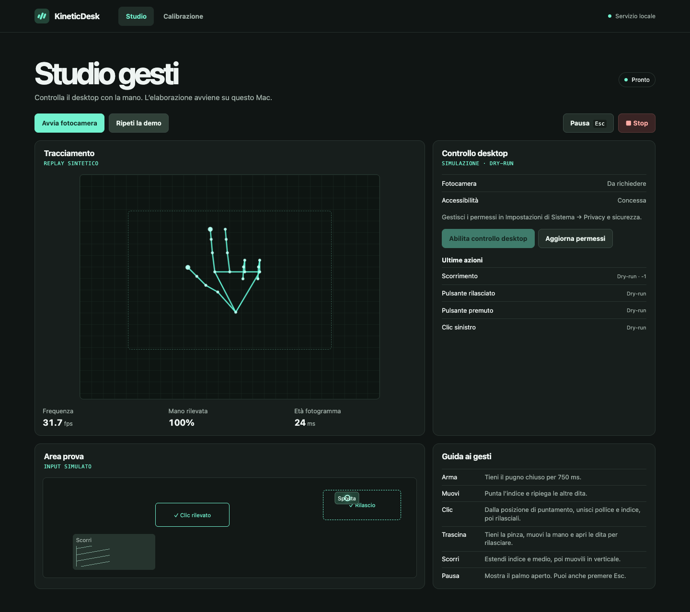

# KineticDesk

Controllo del desktop con una webcam e una mano. KineticDesk elabora i fotogrammi sul Mac e parte in modalità di prova. Il primo rilascio copre movimento del cursore, clic, trascinamento, scorrimento e pausa.



## Avvio

Servono macOS, Node.js 22 e [uv](https://docs.astral.sh/uv/). In alternativa a uv, usa Python 3.11 o 3.12. Esegui dalla cartella del repository:

```sh
python3 scripts/bootstrap.py
python3 scripts/dev.py
```

Apri l’indirizzo stampato dal processo, di norma `http://127.0.0.1:5173`. Se la porta è occupata, esegui `python3 scripts/dev.py --port 5174`. Il bootstrap scarica le dipendenze bloccate e il modello ufficiale. Lo Studio funziona offline dopo l’installazione.

Scegli **Demo dei gesti** per riprodurre una sequenza sintetica nell’area prova. Per usare la mano, premi **Avvia fotocamera**, consenti l’accesso macOS e prova gli stessi gesti in **dry-run**. L’anteprima video è facoltativa. La sovrapposizione dei punti della mano è attiva durante il tracciamento.

Per inviare input a macOS, concedi **Accessibilità** in **Impostazioni di Sistema → Privacy e sicurezza** all’app che lancia il processo. Per un avvio dal terminale, inizia con Terminale o iTerm. Se macOS attribuisce l’accesso a Python o all’app ospitante, usa il nome mostrato dal sistema. Riavvia dal terminale dopo la modifica se macOS lo richiede. Premi **Abilita controllo desktop**, poi chiudi il pugno per circa 750 ms. Torna al dry-run con **Avvia dry-run**.

| Gesto | Azione |
| --- | --- |
| Pugno per 750 ms | Arma la sessione. |
| Indice disteso, altre dita ripiegate | Muove il cursore. Smetti di puntare per fermarlo. |
| Pinza breve partendo dal puntamento | Clic sinistro al rilascio. |
| Pinza tenuta almeno 450 ms | Afferra. Muovi la mano per trascinare e apri le dita per rilasciare. |
| Indice e medio distesi, anulare e mignolo piegati | Scorri spostando le dita in verticale. |
| Palmo aperto | Pausa. Per riprendere il controllo desktop, concedi di nuovo il consenso nello Studio e fai il pugno. |

**Esc** mette in pausa quando lo Studio ha il focus. **Stop** spegne anche la fotocamera. Puoi arrestare il processo con **Ctrl+C** nel terminale da cui lo hai avviato. Un angolo del display principale attiva il fail-safe alla successiva azione di input. Quando la scheda viene nascosta, il controllo desktop va in pausa.

## Verifiche e compatibilità

```sh
python3 scripts/verify.py
.venv/bin/python scripts/benchmark.py --replay tests/fixtures/
cd frontend
npx playwright install chromium
npx playwright test
```

Per Playwright, avvia prima lo Studio sulla porta 5174. Le verifiche automatiche usano esclusivamente il replay o un adattatore finto.

Su macOS Apple Silicon sono stati verificati lo Studio, i cinque gesti in replay, il rilevamento delle autorizzazioni, l’inizializzazione Quartz e l’inferenza MediaPipe su un fotogramma vuoto. Restano da verificare il tracciamento di una mano reale e l’invio di input al desktop. L’adattatore desktop mappa il display principale. Windows, Linux e multi-monitor non sono supportati nell’MVP.

- [Architettura e modello](docs/architecture.md)
- [Macchina a stati](docs/gesture-state-machine.md)
- [Calibrazione e prova con webcam](docs/calibration.md)
- [Privacy e sicurezza](docs/privacy-security.md)
- [Benchmark e protocollo di valutazione](docs/benchmarks.md)

Il codice è distribuito con [licenza MIT](LICENSE). Il modello viene scaricato dalla fonte ufficiale e rimane fuori dal repository.
