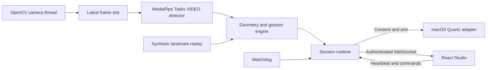

# Architecture

Camera capture and inference run on separate threads. The handoff holds one frame.
Inference uses the newest frame and drops stale frames. The runtime serializes
adapter calls, external commands, transitions and release under one lock.
The independent watchdog expires the browser lease and ends a stalled camera session.
The browser receives snapshots at approximately 15 Hz. OS actions use the worker's
gesture rate directly. The adapter uses Quartz logical coordinates and explicit
drag events. PyAutoGUI's fail-safe remains enabled.

The compiled Vite UI is served by FastAPI on the same origin as its WebSocket.
The project chooses one hand and one primary display to keep gesture arbitration
and macOS coordinate mapping tractable. Vision, geometry/state, and OS output can
be exercised independently.

## Model asset

MediaPipe Hand Landmarker float16/1, 7,819,105 bytes.

- [Official Hand Landmarker documentation](https://developers.google.com/edge/mediapipe/solutions/vision/hand_landmarker?tab=Python)
- [Official model asset](https://storage.googleapis.com/mediapipe-models/hand_landmarker/hand_landmarker/float16/1/hand_landmarker.task)
- SHA-256 `fbc2a30080c3c557093b5ddfc334698132eb341044ccee322ccf8bcf3607cde1`

The bootstrap verifies the stored asset on subsequent runs. The repository
distributes source code and synthetic landmarks. It does not redistribute the model.
