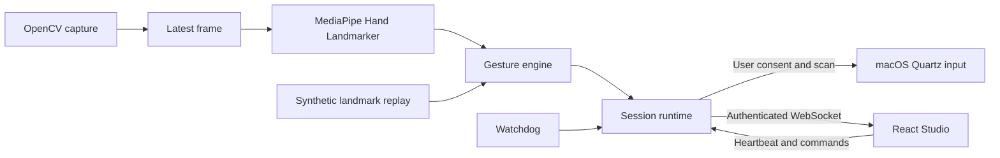

# Architecture

OpenCV captures frames on one thread. MediaPipe processes the newest frame on
another thread. The one-frame buffer lets the capture thread overwrite frames
that inference has yet to pick up. The gesture engine translates landmarks
into input events. Synthetic replay feeds the same engine without a camera.

The runtime uses a lock to coordinate commands, gesture state, input events,
and button release. A watchdog checks the Studio lifecycle signal, pauses on
prolonged tracking loss, and stops stalled camera sessions. The macOS app uses an
AppKit timer to keep the connected Studio session alive when WebKit slows its
timers in the background. The browser version uses a WebSocket heartbeat.
Closing the socket stops capture and releases input. The Studio reconnects
without arming the pointer.

The Studio receives state updates at up to 30 Hz. The preview encodes at up to
15 Hz and the server sends each image only once per connection. Camera capture
requests 60 fps and uses the rate available from the device. Native input still
follows fresh tracking frames at the detector's rate.

FastAPI serves the compiled Vite interface and WebSocket on one loopback origin.
The macOS app runs the same service in-process on an available loopback port
and displays the Studio in a native WebKit window. The pointer adapter uses
Quartz logical coordinates for the primary display, sends explicit drag events,
and keeps the PyAutoGUI corner fail-safe enabled. Gesture recognition tracks
one hand at a time.

## Model

KineticDesk uses MediaPipe Hand Landmarker float16/1. The model file is 7,819,105
bytes. The bootstrap verifies the file size and checksum before using the
downloaded model. The native build bundles the verified local copy. The Git
repository contains synthetic landmarks and source code.

- [MediaPipe Hand Landmarker documentation](https://developers.google.com/edge/mediapipe/solutions/vision/hand_landmarker?tab=Python)
- [Official model download](https://storage.googleapis.com/mediapipe-models/hand_landmarker/hand_landmarker/float16/1/hand_landmarker.task)
- SHA-256 `fbc2a30080c3c557093b5ddfc334698132eb341044ccee322ccf8bcf3607cde1`
